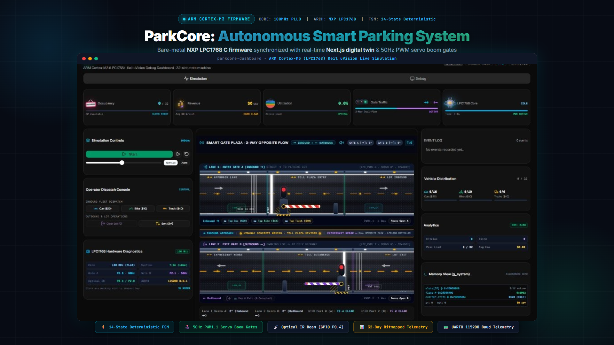

# ParkCore — Autonomous Smart Parking System

<p align="center">
  
</p>

<p align="center">
  
  
  
  
  
  
</p>

---

## 🚀 Overview

**ParkCore** is a high-performance, deterministic smart parking infrastructure system that bridges **bare-metal embedded C firmware** (targeted for the NXP LPC1768 ARM Cortex-M3 @ 100MHz PLL0) with a **real-time 60 FPS web digital twin**.

It provides complete deterministic state management, dual-lane highway toll plaza actuation with 50Hz PWM boom gates, optical IR beam interrupt triggers, 32-bay spatial memory allocation, and real-time hardware register introspection.

---

## ⚡ Core Features

- **14-State Deterministic Finite State Machine (FSM)**  
  Zero runtime dynamic memory allocation (`malloc`), bitpacked 16-bit register flags, re-entrant state transitions, and Keil RTX RTOS compatibility.
- **Dual-Lane Highway Toll Plaza**  
  2-way opposite flow (Inbound Street $\rightarrow$ Lot, Outbound Lot $\rightarrow$ Highway) with optical IR beam sensors (GPIO Port 0 interrupts) and 50Hz hardware PWM servo boom gate control (1.0ms closed $\rightarrow$ 2.0ms 90° clearance).
- **32-Bay Spatial Allocation Matrix**  
  Bitmapped occupancy tracking partitioned across 16 Cars ($20/hr), 10 Bikes ($10/hr), and 6 Heavy Freight Trucks ($40/hr) with individual bay telemetry inspection HUDs.
- **Hardware Register Introspection & Debug Console**  
  Emulates Keil $\mu$Vision watch window with live memory mapping (`g_system` SRAM), PINSEL registers, GPIO directional state, SysTick 10ms hardware interrupts, and 115200 8-N-1 UART0 debug telemetry.
- **Automated Financial Ledger & Tariff Engine**  
  Real-time rate calculation engine calculating duration-based billing, total entries/exits, revenue metrics, and dynamic sorting algorithms ($O(n^2)$ Bubble Sort on bay occupancy).

---

## 🛠️ System Architecture

```
                  ┌──────────────────────────────────────────────┐
                  │       NXP LPC1768 (ARM Cortex-M3)            │
                  │       Clock: 100MHz PLL0 | SysTick 10ms      │
                  └──────────────────────┬───────────────────────┘
                                         │
                 ┌───────────────────────┴───────────────────────┐
                 ▼                                               ▼
   ┌───────────────────────────┐                   ┌───────────────────────────┐
   │    Sensory & Actuation    │                   │   Core State Machine      │
   │  • Optical IR Beam (P0.4) │                   │  • 14 Deterministic States│
   │  • 50Hz PWM Servos (P2.0) │                   │  • Bitpacked Register Flag│
   │  • ANPR OCR Vehicle Scan  │                   │  • Keil RTX Task Scheduler│
   └─────────────┬─────────────┘                   └─────────────┬─────────────┘
                 │                                               │
                 └───────────────────────┬───────────────────────┘
                                         │ UART0 115200 Baud Telemetry
                                         ▼
                  ┌──────────────────────────────────────────────┐
                  │          Real-Time Digital Twin              │
                  │   Next.js 16 • React 19 • TypeScript         │
                  │   60 FPS Canvas & Web Audio Sound Engine     │
                  └──────────────────────────────────────────────┘
```

---

## 🚦 Fee Structure & Allocation Matrix

| Vehicle Category | Bays | Capacity | Rate / Hour | Sensor Pin | Actuator |
| :--- | :--- | :--- | :--- | :--- | :--- |
| **Cars** | `#00 – #15` | 16 Bays | **$20.00** | GPIO Port 0.4 (IR A) | PWM1.1 (Servo A) |
| **Bikes** | `#16 – #25` | 10 Bays | **$10.00** | GPIO Port 0.4 (IR A) | PWM1.1 (Servo A) |
| **Trucks** | `#26 – #31` | 6 Bays | **$40.00** | GPIO Port 0.4 (IR A) | PWM1.1 (Servo A) |

---

## 💻 Quick Start

### 1. Clone the repository
```bash
git clone https://github.com/SyedAynan/Smart-Parking-Management-System.git
cd Smart-Parking-Management-System
```

### 2. Install dependencies
```bash
npm install
```

### 3. Launch local simulation server
```bash
npm run dev
```
Open **[http://localhost:3000](http://localhost:3000)** in your browser to interact with the live simulation.

---

## 📁 Repository Structure

```
Smart-Parking-Management-System/
├── app/                        # Next.js App Router (Layout & Pages)
├── components/                 # UI & Embedded Simulation Components
│   ├── animated-barrier-gate.tsx  # Dual-lane toll plaza & PWM servo gates
│   ├── bay-telemetry-hud.tsx      # Slot inspection & sensor HUD
│   ├── control-panel.tsx          # SysTick clock & dispatch controls
│   ├── data-view-panel.tsx        # 14-state FSM & register flag watch window
│   ├── parking-dashboard.tsx      # Main master dashboard & metrics ribbon
│   ├── parking-slot-grid.tsx      # 32-bay interactive spatial matrix
│   └── vehicle-visuals.tsx        # Dynamic vehicle sprites & ANPR OCR tags
├── hooks/                      # Custom simulation hooks
│   └── use-parking-simulation.ts  # Master simulation loop & state dispatcher
├── lib/                        # Core algorithms & firmware generators
│   ├── parking-system.ts          # Embedded logic mirroring C firmware
│   └── simulation-audio.ts        # Synthesized sound effects engine
├── public/                     # Static assets, icons, and official banner
├── scripts/                    # Automation, benchmarking & render pipelines
└── tests/                      # Automated unit tests & regression suite
```

---

## 📜 License

Distributed under the **MIT License**. See `LICENSE` for more information.
