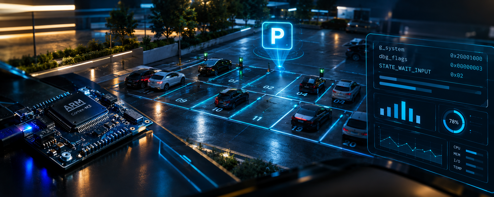

# ParkCore — Smart Parking Management Simulator

<p align="center">
  
</p>

Interactive web dashboard simulating an **ARM Cortex-M3 (LPC1768)** parking management system. Built with Next.js 16, React 19, TypeScript, and Tailwind CSS 4.

Interactive web dashboard simulating an **ARM Cortex-M3 (LPC1768)** parking management system. Built with Next.js 16, React 19, TypeScript, and Tailwind CSS 4.

## Features

- **32-slot parking grid** (16 Cars, 10 Bikes, 6 Trucks)
- **Real-time state machine visualization** — 14 states (IDLE → PROCESS_ENTRY → SORT_SLOTS → DISPLAY, etc.)
- **Flag monitoring panel** — all 14 system flags (INIT_DONE, SLOT_FULL, FEE_CALCULATED, etc.)
- **Event log** — timestamped ENTRY/EXIT/SORT/ERROR events
- **Debug console** — simulates Keil Watch Window (dbg_ variables)
- **Manual + Auto modes** — click slots manually or run auto simulation
- **Fee calculation** — duration-based billing per vehicle type
- **Bubble sort animation** — slot reorganization when state changes
- **C source code viewer** — shows generated Keil-compatible C source

## Quick Start

```bash
npm install
npm run dev
# → http://localhost:3000
```

## Deploy on Vercel

```bash
vercel deploy
```

Or push to GitHub and import at https://vercel.com — zero config needed.

## Architecture

- `app/` — Next.js App Router (layout, page, globals)
- `components/` — Dashboard, slot grid, state machine, flags panel, debug console, event log, source viewer
- `lib/` — `parking-system.ts` (mirrors C logic), `keil-source-generator.ts` (exports embedded C)
- `hooks/` — `use-parking-simulation.ts` (state management + timer loop)

## Fee Structure

| Vehicle | Slots | Rate/Hour |
|---------|-------|-----------|
| Car     | 0-15  | $20       |
| Bike    | 16-25 | $10       |
| Truck   | 26-31 | $40       |

## License

MIT — Academic project for Data Science Engineering coursework.
