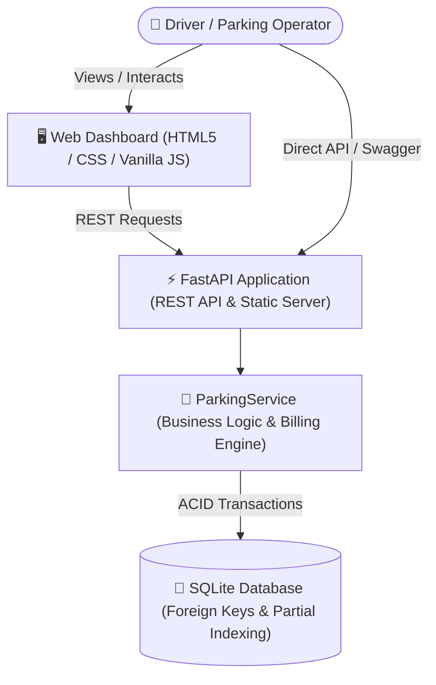

# 🅿️ Smart Parking Management System

[](https://www.python.org/)
[](https://fastapi.tiangolo.com)
[](https://www.sqlite.org/)
[](tests/)
[](LICENSE)
[](https://peps.python.org/pep-0008/)

A high-performance, real-time **Smart Parking Management System** built with **FastAPI** and **SQLite**, paired with a responsive **live web dashboard**. Features automated slot allocation, entry & exit ticketing, dynamic hourly billing with configurable grace periods, real-time occupancy metrics, and comprehensive financial reports.

---

## 🌟 Key Features

- **📍 Multi-Lot & Slot Management**: Configure multiple parking lots with custom hourly tariffs. Provision slots individually or in batch (e.g., `A1`, `A2`, `B1`, `B2`).
- **🚗 Automated Slot Allocation**: First-available slot assignment algorithm upon vehicle entry with duplicate-entry prevention.
- **⏱️ Precision Billing Engine**: Automated duration calculation rounded up to the nearest hour, with configurable grace periods (e.g., first 15 minutes free).
- **📊 Real-time Occupancy & Revenue Analytics**: Instant reporting on total slots, occupied vs. available slots, occupancy percentages, and cumulative revenue.
- **🖥️ Responsive Live Dashboard**: Modern, lightweight HTML5/CSS3/Vanilla JS control center featuring live slot availability grids, vehicle entry/exit controls, and active ticket ledgers.
- **⚡ Interactive OpenAPI / Swagger Docs**: Native FastAPI interactive API testing and endpoint exploration out of the box at `/docs` and `/redoc`.
- **🛡️ ACID-Compliant Persistence**: SQLite backend with foreign key constraints, parameterized queries, and optimized partial indexes (`idx_tickets_active`).
- **🧪 100% Automated Test Suite**: End-to-end integration tests using `pytest` and `httpx` validating entry/exit workflows, billing math, and edge cases.

---

## 🏗️ System Architecture



### State Workflow

```
[ Vehicle Arrives ]
        │
        ▼
[ POST /api/entry ] ──► (Finds next free slot & creates active ticket) ──► Slot marked OCCUPIED
        │
        ▼
   ... Parked ...
        │
        ▼
[ POST /api/exit ]  ──► (Calculates duration: Grace period vs. Hourly) ──► Slot marked FREE
        │
        ▼
[ Ticket Settled & Billed ]
```

---

## 🗂️ Project Structure

```
Smart-Parking-Management-System/
├── src/
│   └── parking/
│       ├── __init__.py          # Package initialization
│       ├── config.py            # Runtime configuration & environment variables
│       ├── database.py          # SQLite connection manager, schema & indexing
│       ├── main.py              # FastAPI application, route handlers & static mount
│       ├── schemas.py           # Pydantic v2 validation models
│       ├── service.py           # Core domain logic: slots, tickets, billing math
│       └── static/              # Embedded web dashboard
│           ├── app.js           # Live UI state & API interaction controller
│           ├── index.html       # Operator dashboard interface
│           └── styles.css       # Clean, modern UI styling
├── tests/
│   ├── __init__.py
│   └── test_api.py              # Pytest end-to-end test suite (in-memory SQLite)
├── .editorconfig                # Standardized code formatting settings
├── .env.example                 # Example environment variables
├── .gitignore                   # Version control ignore rules
├── CONTRIBUTING.md              # Contribution workflow & guidelines
├── LICENSE                      # MIT Open Source License
├── Makefile                     # Developer automation commands
├── pyproject.toml               # Python project configuration & dependencies
├── README.md                    # Project documentation
└── SECURITY.md                  # Security reporting policy
```

---

## 🚀 Quick Start

### 1. Prerequisites

- **Python 3.11+** installed
- **Git**

### 2. Clone the Repository

```bash
git clone https://github.com/SyedAynan/Smart-Parking-Management-System.git
cd Smart-Parking-Management-System
```

### 3. Create a Virtual Environment

```bash
# Windows (PowerShell)
python -m venv .venv
.venv\Scripts\Activate.ps1

# Linux / macOS
python3 -m venv .venv
source .venv/bin/activate
```

### 4. Install Dependencies

```bash
pip install -e ".[dev]"
```

### 5. Configure Environment (Optional)

```bash
# Windows
copy .env.example .env

# Linux / macOS
cp .env.example .env
```

Default configuration values:

| Variable | Default | Description |
|---|---|---|
| `PARKING_DB_PATH` | `parking.db` | Path to SQLite database file |
| `PARKING_DEFAULT_HOURLY_RATE` | `50.0` | Default hourly parking fee in currency units |
| `PARKING_GRACE_MINUTES` | `15` | Free parking duration threshold in minutes |
| `PORT` | `8000` | Port for the HTTP server |

### 6. Run the Application

```bash
# Using Makefile
make run

# Or directly with uvicorn
uvicorn parking.main:app --reload --port 8000
```

- **Live Dashboard:** [http://localhost:8000](http://localhost:8000)
- **Interactive Swagger Docs:** [http://localhost:8000/docs](http://localhost:8000/docs)
- **ReDoc Documentation:** [http://localhost:8000/redoc](http://localhost:8000/redoc)

---

## 🔌 API Reference

### Parking Lots

| Method | Endpoint | Description | Request Body |
|---|---|---|---|
| `GET` | `/api/lots` | List all parking lots | None |
| `POST` | `/api/lots` | Create a new lot | `{"name": "Downtown Deck", "hourly_rate": 60.0}` |
| `GET` | `/api/lots/{lot_id}/slots` | List all slots for a lot | None |
| `POST` | `/api/lots/{lot_id}/slots` | Batch add slots to lot | `{"codes": ["A1", "A2", "A3", "B1"]}` |

### Vehicle Operations

| Method | Endpoint | Description | Request Body |
|---|---|---|---|
| `POST` | `/api/entry` | Vehicle entry (auto-allocates slot) | `{"lot_id": 1, "plate": "ABC-1234"}` |
| `POST` | `/api/exit` | Vehicle exit (calculates bill & frees slot) | `{"lot_id": 1, "plate": "ABC-1234"}` |

### Analytics & Reports

| Method | Endpoint | Description |
|---|---|---|
| `GET` | `/api/lots/{lot_id}/active` | Retrieve all active tickets with parked plates & elapsed times |
| `GET` | `/api/lots/{lot_id}/report` | Real-time occupancy metrics (total, occupied, free %, revenue) |

---

## 💡 Billing Logic Explained

The billing engine in `src/parking/service.py` calculates charges based on elapsed time:

$$\text{Stay Duration} = \text{Exit Time} - \text{Entry Time}$$

1. **Grace Period**: If $\text{Stay Duration} \le \text{PARKING\_GRACE\_MINUTES}$ (default 15 minutes), the total fee is **`0.00`** (Free).
2. **Hourly Billing**: If duration exceeds the grace period, duration is rounded up to the next full hour:
   $$\text{Charge} = \lceil \frac{\text{Duration in Minutes}}{60} \rceil \times \text{Hourly Rate}$$

### Example Calculations ($50.00 / hr, 15 min grace):
- **10 minutes parked**: `$0.00` *(within grace period)*
- **16 minutes parked**: `$50.00` *(1 hour billed)*
- **65 minutes parked**: `$100.00` *(rounded up to 2 hours)*

---

## 🧪 Running Tests

The test suite validates database models, API routes, business logic, and error handlers with an in-memory SQLite instance:

```bash
# Run pytest directly
pytest -v

# Or via Makefile
make test
```

### Linting

```bash
make lint
```

---

## 🔒 Security & Best Practices

- Parameterized SQL queries prevent SQL injection attacks.
- Foreign key enforcement ensures referential integrity across lots, slots, and tickets.
- Dedicated partial database index `idx_tickets_active` ensures instant lookups on busy parking lots.
- Input validation enforced at all endpoints via Pydantic v2 schemas.
- For security disclosure procedures, see [SECURITY.md](SECURITY.md).

---

## 🤝 Contributing

Contributions, bug reports, and suggestions are welcome! Please review [CONTRIBUTING.md](CONTRIBUTING.md) for branch naming conventions, PR guidelines, and commit standards.

---

## 📄 License

This project is licensed under the MIT License - see the [LICENSE](LICENSE) file for details.
